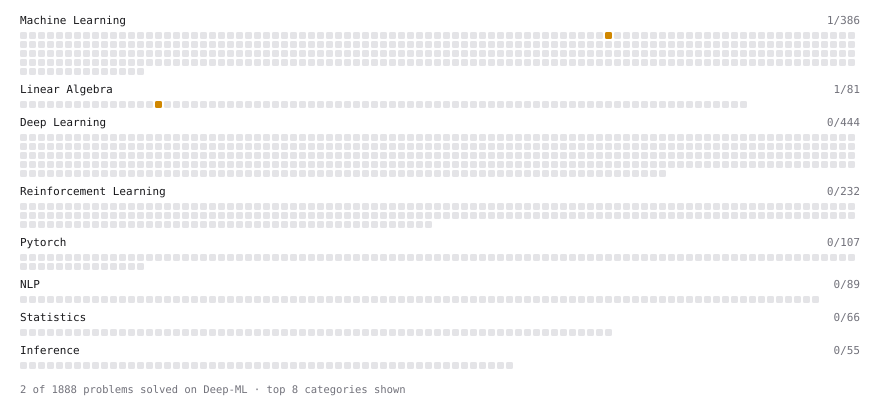

# Deep-ML

My machine learning practice from [Deep-ML](https://www.deep-ml.com). Every solution here was written by hand.

**3** solved · 2 problems · 0 labs · 1 math

[**Browse the interactive portfolio**](https://Samayank.github.io/deep-ml/) to replay this filling in over time.

## Problems

| | Difficulty | Solved | |
| --- | --- | --- | --- |
| [Calculate Correlation Matrix](https://www.deep-ml.com/problems/37) | medium | 2026-11-04 | [solution](problems/0037-calculate-correlation-matrix) |
| [Gaussian Naive Bayes Classifier](https://www.deep-ml.com/problems/261) | medium | 2026-11-04 | [solution](problems/0261-gaussian-naive-bayes-classifier) |

## Math

| | Difficulty | Solved | |
| --- | --- | --- | --- |
| [Naive Bayes and the Conditional Independence Assumption](https://www.deep-ml.com/math-problems/106) | medium | 2026-11-02 | [solution](math/0106-naive-bayes-and-the-conditional-independence-assumption) |

---

_This file is regenerated by Deep-ML on every push._
